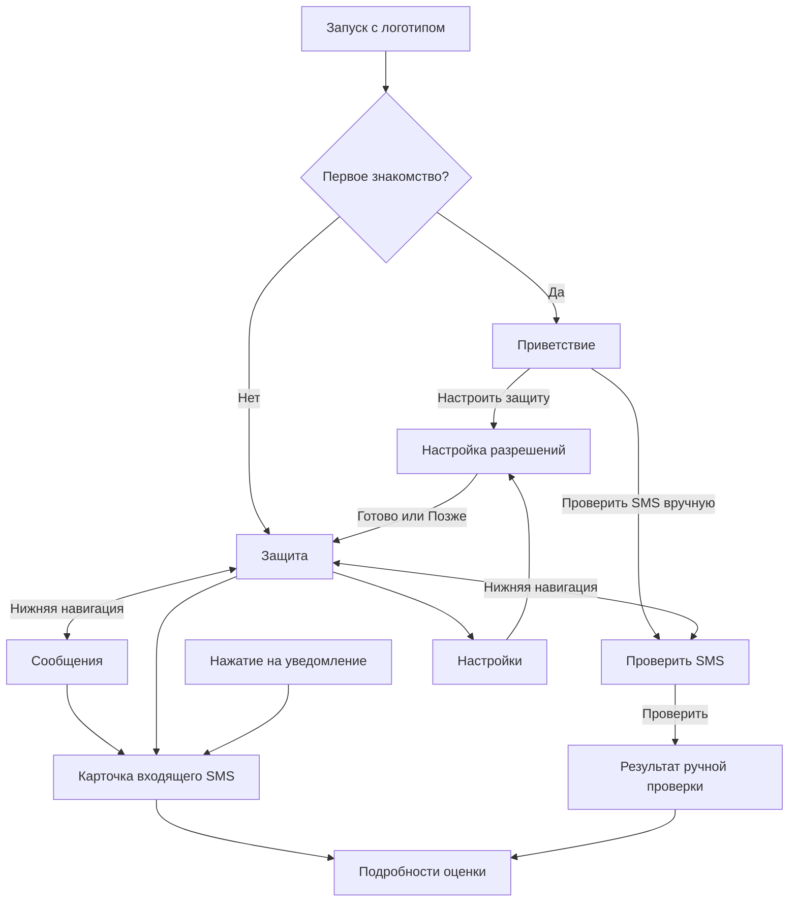

# Qorğan — UX самостоятельного мобильного приложения

Дата: 7 ноября 2026. Статус: UX согласован пользователем; реализация начата. Дополнительное условие: сохранить существующие цветовые токены QorganColors.

## 1. Основа решения

Пользователь подтвердил: сайт и приложение представляют разные, независимые модули; общих продуктовых функций между ними не планируется. Требуется сначала определить UX, затем перейти к UI. На входе используется существующий логотип Qorğan.

Предлагаемое решение: мобильное приложение работает без аккаунта. Нет регистрации, авторизации, гостевого режима, профиля, восстановления пароля и выхода. Первый экран знакомит с продуктом и помогает начать работу. Связь с сайтом ограничена брендом; модули проверки документов и дипфейков в приложение не добавляются.

Остальные решения ниже — предложения автора UX, а не дополнительные требования пользователя. Они опираются на существующее Flutter-приложение. Этот документ описывает целевое поведение; новые экраны и изменения поведения ещё не реализованы.

## 2. Задачи и границы

Два основных сценария:

1. «Мне пришло сомнительное SMS — хочу быстро проверить текст и понять, что делать».
2. «Хочу получать предупреждения о подозрительных новых SMS без ручной проверки каждого сообщения».

Успешный первый сеанс заканчивается либо результатом ручной проверки, либо включением проверки новых SMS с доступными предупреждениями. Для начала не нужны личные данные, интернет или обучение по нескольким слайдам.

В этот этап входят первый запуск, навигация, настройка разрешений, состояния защиты, ручная проверка, история входящих SMS, детали результата, уведомления, настройки и очистка локальной истории.

За пределами этапа: аккаунты и сервер авторизации, облачная история, платная подписка, семейные роли, интеграция с сайтом, обработка мессенджеров и звонков, автоматическая блокировка или удаление SMS. Алгоритм классификации и его пороги этот UX не меняет. Новый сервис фильтрации iOS — отдельная работа; сейчас на платформах без сервиса приёма доступна ручная проверка.

Неудачный UX: заставлять регистрироваться или выдавать разрешения ради ручной проверки; скрывать эту проверку в меню; обещать гарантированную безопасность; выдавать балл правила за вероятность; показывать демонстрационные SMS как реальные; говорить о включённой защите при неизвестном состоянии сервиса.

## 3. Карта приложения

На трёх корневых разделах постоянная нижняя навигация: **«Защита» · «Проверить SMS» · «Сообщения»**. Шестерёнка открывает настройки. Аватар и меню из четырёх точек убираются. Карточка SMS, настройка, результат и настройки — вложенные экраны с обычным возвратом, без дублирования нижней навигации.

Переключение разделов сохраняет черновик ручного текста, фильтр и положение списка в текущем сеансе. Повторный тап по выбранному разделу не создаёт новый экран. Назад из вложенного экрана возвращает к месту открытия. Назад из корневых разделов «Проверить SMS» и «Сообщения» ведёт на «Защиту», из «Защиты» — обычный выход средствами Android. На корневом экране нет декоративной стрелки назад.

## 4. Первый и повторный запуск

**Заставка.** Существующий фирменный знак и название сохраняются. Инициализация происходит параллельно. Не добавлять дополнительную искусственную паузу. При уменьшении анимации нет движения и плавного исчезновения; при открытии уведомления заставка не задерживает карточку.

**Приветствие, один экран.** Сверху логотип и Qorğan. Заголовок: «Разберитесь в подозрительном SMS». Текст: «Проверяйте сообщения на телефоне и получайте предупреждения о возможном мошенничестве». Короткое пояснение: «Текст SMS не отправляется на сервер».

- На Android: основное действие «Настроить защиту», дополнительное «Проверить SMS вручную».
- На платформе без приёма SMS: основное действие «Проверить SMS», пояснение о ручной проверке; нет неработающей кнопки включения Android-защиты.
- Ссылка «Как обрабатываются данные» открывает локальное информационное представление, из которого можно вернуться к приветствию.
- Нет кнопок Sign in / Sign up / «Продолжить как гость» и запроса имени или номера телефона.

Нажатие любого действия начала работы сохраняет локальный флаг знакомства до перехода дальше. Пропуск разрешений также не возвращает приветствие при следующем запуске. Закрытие приложения на самом приветствии до выбора действия оставляет его на следующий раз. Ошибка сохранения не блокирует ручную проверку: показать ненавязчивое сообщение, что выбор не сохранился и приветствие может появиться снова.

**Обновление существующей установки.** Если нового флага нет, но уже есть сохранённое значение настройки защиты (даже `false`) или SMS в локальной истории, считать знакомство завершённым. Не сбрасывать защиту и историю. Если нет ни одного такого признака, показать приветствие один раз: надёжно отличить старую неиспользованную установку от новой невозможно. Очистка истории не сбрасывает флаг знакомства.

**Повторный запуск.** Открывается «Защита». Запуск по уведомлению имеет приоритет над знакомством и выбранной вкладкой: открывается соответствующее SMS, а назад ведёт на «Защиту». Незавершённое знакомство не появляется поверх карточки.

## 5. Настройка проверки новых SMS

Один экран с двумя последовательными шагами; у каждого видны назначение, состояние и действие:

1. **Новые SMS.** «Доступ нужен, чтобы проверять сообщения при получении. Старую переписку Qorğan не загружает». Кнопка «Разрешить приём SMS» вызывает системный запрос.
2. **Предупреждения.** После получения доступа к SMS: «Уведомим, если найдём подозрительное сообщение. Текст SMS и коды не показываются в предупреждении». Кнопка «Разрешить уведомления» вызывает доступный системный запрос или ведёт к настройке уведомлений, если запрос уже невозможен.

Запрашиваются только реально отсутствующие разрешения. Уже выданный доступ отмечается как готовый. Пользователь всегда может выбрать «Позже»: с первого знакомства он попадает на «Защиту», при повторной настройке возвращается к месту её открытия. На Android без отдельного системного диалога уведомлений проверяется их фактическая доступность, в том числе канал предупреждений.

Когда оба условия выполнены, действие **«Включить защиту»** сохраняет пользовательское намерение. До подтверждённого сохранения нет состояния «включено». После успеха — экран «Защита» с коротким подтверждением «Проверка новых SMS включена». При ошибке остаются объяснение и «Повторить»; разрешения не запрашиваются заново.

После отказа не открывать следующий системный запрос автоматически. Показать, какая возможность недоступна, и оставить ручную проверку доступной. Повторный запрос — только по новому явному нажатию и если ОС его допускает; иначе «Открыть настройки Android». Возврат из системных настроек обновляет состояние без повторного знакомства.

Изначальное включение требует обоих разрешений. Если уведомления отключили позже, уже включённый приём SMS не отключается молча: интерфейс сообщает об ограничении, история продолжает пополняться, насколько это позволяет сервис.

## 6. Раздел «Защита»

Главное содержание в порядке важности: состояние проверки, действие для устранения проблемы при её наличии, заметный переход «Проверить SMS», последние входящие сообщения. Статистика вторична и появляется только когда есть реальные записи; подпись «В сохранённой истории» исключает впечатление счётчика за всё время. История ограничена последними 100 входящими SMS.

Состояния определяются реальными данными, с таким приоритетом:

| Условие | Сообщение и действие |
| --- | --- |
| Сервис не поддерживается | «Доступна ручная проверка SMS» → «Проверить SMS» |
| Начальная загрузка | «Проверяем состояние…», без временного зелёного или выключенного статуса; ручная проверка доступна |
| Ошибка определения состояния | «Не удалось проверить состояние» → «Повторить»; прошлый статус не выдаётся за текущий |
| Намерение включения выключено | «Автопроверка выключена» → «Настроить защиту»; при уже выданных разрешениях настройка сразу предлагает включение |
| Намерение включено, SMS недоступны | «Нет доступа к новым SMS» → «Восстановить доступ» |
| Намерение включено, SMS доступны, уведомления недоступны | «Предупреждения выключены». Пояснение: «Проверка новых SMS включена, уведомления недоступны» → «Включить уведомления» |
| Намерение включено, доступы и инициализация подтверждены | «Проверка новых SMS включена». Подпись: «Предупреждения о подозрительных сообщениях включены» |

Ни одно состояние не обещает постоянную работу при force-stop или ограничениях Android. Объяснение этих ограничений находится в помощи о защите, а не в обязательном первом знакомстве.

Пустая история при включённой проверке: «Новых SMS пока нет. Они появятся здесь после получения» и действие ручной проверки. При выключенной — «Включите проверку новых SMS или проверьте текст вручную». Нулевая история не изображается как результат успешного сканирования телефона.

## 7. Ручная проверка

Экран «Проверить SMS»: многострочное поле, системная вставка и явная кнопка «Вставить текст», основное действие «Проверить». Буфер обмена читается только после нажатия. Нет автоматической проверки буфера, демотекстов, запроса SMS-разрешений и предварительного входа.

- Пустое поле или одни пробелы: «Проверить» недоступно. Пустой буфер объясняется коротким сообщением.
- Непустой текст: действие «Проверить» запускает локальный анализ и открывает результат. Во время обработки повторное нажатие недоступно; искусственной задержки нет.
- Результат относится к снимку проверенного текста. «Изменить текст» или назад возвращают в поле с этим текстом; повторная проверка заменяет предыдущий результат. Старый вывод не выдаётся за оценку изменённого текста.
- Ошибка анализа: текст сохраняется, можно повторить; ошибка не отображается как низкий риск.
- «Очистить» удаляет текущий черновик и его результат. Черновик хранится только в памяти текущего процесса, а не в SQLite или облаке. Во время системного диалога и обычного сворачивания он сохраняется, пока жив процесс.

Ручные проверки не добавляются в раздел «Сообщения»: он содержит входящие SMS. На ручном экране это объяснено подписью «Результат этой проверки не сохраняется в историю». Отправитель не запрашивается; в подробностях результата указано «Проверен только текст; отправитель не проверялся». Не создавать фиктивного отправителя или времени получения.

## 8. Единое представление результата

Одинаковые три категории во всех экранах, определяемые `MessageRisk`, без собственных UI-порогов:

| Состояние | Название | Основной смысл |
| --- | --- | --- |
| `clear` | «Низкий риск» | «По найденным признакам риск низкий. Это не подтверждает подлинность отправителя» |
| `watch` | «Стоит проверить» | «Есть признаки, на которые стоит обратить внимание» |
| `warn` | «Подозрительное SMS» | «Обнаружены признаки возможного мошенничества» |

Далее — короткое действие, связанное с найденными признаками: не передавать запрошенный код, не переходить по подозрительной ссылке, самостоятельно проверить обращение через официальный канал указанной организации. Советы не предполагают, что каждое сообщение связано с банком.

Порядок карточки: вывод → что делать → причины оценки → исходное сообщение → необязательные подробности. На входящем SMS видны реальный отправитель и время, при отсутствии данных — честная подпись об их отсутствии. В ручной проверке — только введённый текст. Ссылки в исходном тексте не открываются нажатием; содержимое можно выделить и скопировать.

Причины перечисляют обнаруженные сигналы без приписывания отправителю подтверждённой личности. «Подробности оценки» раскрывают числовой балл и вклад признаков. Балл не называется процентом, вероятностью или оценкой нейросети. Экспертная матрица не нужна для понимания результата; при UI-проектировании можно заменить её читаемым списком вкладов. Существующие веса и пороги остаются в доменном слое.

Состояние передаётся текстом и символом, а не одним цветом. В интерфейсе нет «Заблокировано», «Пропущено» и «SMS безопасно»: приложение предупреждает, но не управляет доставкой SMS и не гарантирует безопасность.

## 9. Раздел «Сообщения» и уведомления

История входящих: последние 100 сохранённых SMS, новые сверху. Фильтры: «Все», «Подозрительные» (`warn`), «Стоит проверить» (`watch`), «Низкий риск» (`clear`). Карточка строки содержит реального отправителя, время, короткое описание по обнаруженным признакам и категорию риска. Полный текст открывается в деталях. Не добавлять фиктивные непрочитанные сообщения или счётчики.

Фильтр без результатов: «Сообщений с такой оценкой нет» и «Показать все». Пустая общая история отличается от ошибки загрузки. При ошибке — «Не удалось загрузить сообщения», «Повторить»; доступ к ручной проверке сохраняется. При поступлении SMS список обновляется без сброса выбранного фильтра и без принудительного ухода с текущего экрана.

Уведомление появляется только для `warn`, без текста SMS, кодов и персональных данных. Нажатие открывает запись по её идентификатору. Если запись удалена, вытеснена из последних 100 или не сохранилась, показать «Сообщение больше не хранится в Qorğan» и «К сообщениям». Никогда не подменять выбранное SMS последним доступным. При ошибке чтения — отдельная ошибка с повтором, а не утверждение об удалении.

Назад из карточки, открытой внутри приложения, возвращает к месту открытия. Если уведомление открыло приложение снаружи, назад ведёт на «Защиту». Нажатие уведомления в уже открытом приложении открывает нужное SMS поверх корня «Защита», сохраняя черновик ручной проверки в памяти сеанса.

## 10. Настройки и данные

Настройки содержат:

- Управление проверкой новых SMS и состояние разрешений. Выключение применяется сразу после успешного сохранения, без модального подтверждения; история остаётся. Если запись не удалась, переключатель возвращается к подтверждённому состоянию и появляется ошибка.
- «Как работает защита»: возможности, ограничения фона, инструкция по восстановлению разрешений; Android-специфичные пункты скрыты на остальных платформах.
- «Данные на устройстве»: анализ локальный, хранятся последние 100 полученных SMS, ручные проверки в историю не попадают, удаления приложения достаточно для удаления его локальных данных при отключённом Android backup. SMS в системном приложении сообщений не изменяются.
- «Очистить историю» при непустой истории. Подтверждение: «Удалить сохранённые SMS из Qorğan? Сообщения в приложении SMS останутся». Кнопки «Отмена» и «Удалить историю». После успеха очищены запись списка, карточки и счётчики; флаг знакомства и настройка защиты сохранены. При ошибке не показывать успешную очистку. Активные уведомления Qorğan отменяются; уже доставленные старые ссылки обрабатываются как отсутствующая запись.
- Версия приложения и существующие лицензии open source.

Если SMS приходит во время очистки, операция имеет определённую границу: удаляются записи из снимка истории, сделанного перед удалением; новое сообщение, сохранённое после снимка, может появиться в истории. Не выключать защиту ради очистки. Реализация синхронизации БД и уведомлений остаётся за разработчиком; уведомление для новой сохранённой записи не должно пропадать из-за очистки старых.

## 11. Доступность и последующий UI

Используется существующий бренд: фирменный знак `BrandMark`, название Qorğan, Manrope и светлая основа. Мятный цвет — бренд и основные действия; предупреждение должно визуально отличаться от благополучного состояния. Конкретные оттенки, сетка, типографическая шкала и композиции экранов определяются на этапе UI.

Ориентиры: удобство на ширине 320–430 логических пикселей, крупный системный текст до 200%, понятные подписи для экранного диктора, зоны нажатия не менее 48×48 логических пикселей, поддержка уменьшения анимации. Длинный отправитель, SMS и перевод не ломают макет. Основное действие доступно при открытой клавиатуре; текстовые результаты можно прокручивать. На текущем этапе интерфейс на русском; добавление казахского и других языков — отдельный объём.

## 12. Изменения относительно текущего приложения

Нужно добавить приветствие и его локальное состояние; заменить скрытые переходы постоянной навигацией; разделить запросы SMS и уведомлений в сервисном API; сделать включение явным после готовности; представить все состояния защиты; добавить явную ручную проверку с результатом по снимку текста; унифицировать три категории и фильтры; исправить переход по устаревшему уведомлению; добавить очистку истории и информацию о данных.

Используются существующие Flutter, локальные настройки, SQLite, SMS-сервис и классификатор. Не требуется auth SDK или новый backend. Существующие изменения алгоритма, базы известных адресов и тестов не относятся к этой UX-задаче и должны сохраняться. Новый UX заменит описания навигации в спецификации светлого UI от 14 октября только после согласования этого документа.

## 13. Критерии готовности UX и будущей реализации

1. Новый пользователь доходит до ручного результата без аккаунта, сети и разрешений на SMS/уведомления.
2. Первый запуск приводит к одному понятному выбору; при повторном запуске знакомство не навязывается.
3. Отказ в любом разрешении оставляет доступный путь продолжения; повторные запросы происходят только по действию пользователя.
4. Возврат из настроек Android обновляет состояние; неизвестный статус и частичная готовность не показаны как полная готовность.
5. При изменении текста старый результат не воспринимается как оценка нового текста; категория совпадает с категорией того же доменного результата на остальных экранах.
6. Все три категории различимы в истории и деталях; баллы и обнаруженные признаки реальны.
7. Уведомление открывает именно своё сообщение или объяснение его отсутствия. История пуста, отфильтрована и не загрузилась — три разных состояния.
8. Очистка удаляет только локальную историю Qorğan, сохраняет настройку защиты и не скрывает ошибки.
9. Навигация сохраняет черновик в текущем сеансе, а системный возврат имеет определённый результат.
10. Экраны проверены с крупным шрифтом, клавиатурой и длинным SMS; нет данных демонстрации в продуктовой сборке.

Для реализации нужны сценарные widget-тесты переходов и состояний, тесты новых операций хранения и разрешений, затем существующие analyze/test-проверки проекта. Реальные системные диалоги и открытие уведомлений проверяются на Android; тесты виджетов не заменяют проверку устройства. На этом этапе создаётся только UX-описание.

## 14. Что согласовать перед UI

Основные предложения автора: отсутствие аккаунта; один экран знакомства; три постоянных раздела; явное действие «Проверить»; ручные результаты без сохранения в истории; полные детали оценки вторичны. Техническую организацию маршрутов, названия ключей настроек, компоненты и разбиение будущего плана определит разработчик в рамках описанного поведения.

После согласования UX следующий этап — план реализации и UI экранов с существующим брендом. Этот документ не задаёт визуальный макет и не считается реализацией новых функций.
